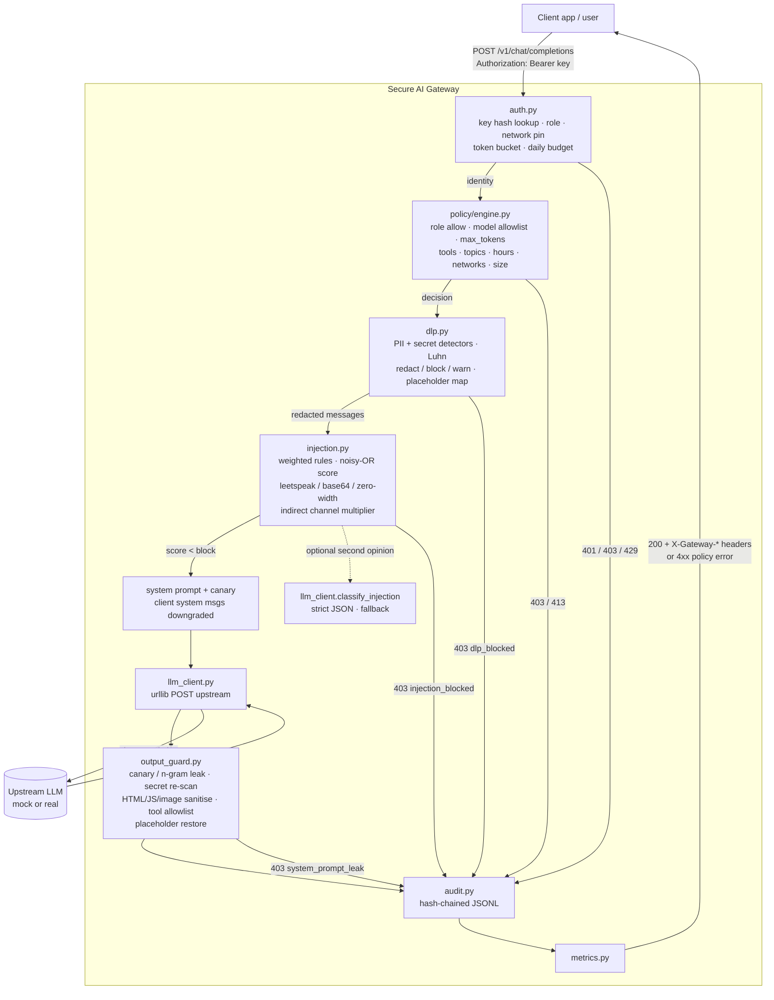
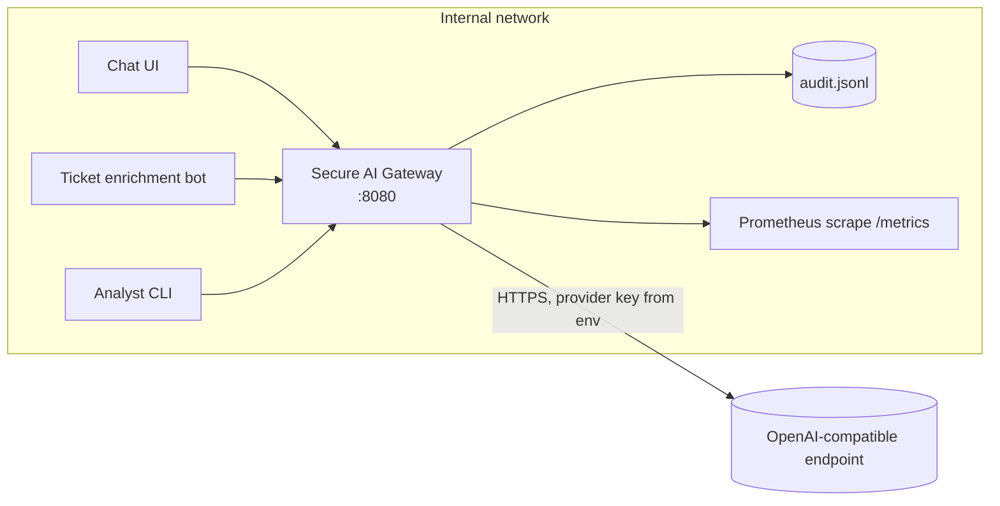

# Architecture

The gateway is a single Flask process that mirrors the upstream
`/v1/chat/completions` contract. Clients change one setting (`base_url`) and
everything else - policy, redaction, screening, audit - happens transparently.

## Request pipeline

Every exit path writes an audit record; blocks never short-circuit logging.

## Components

| Module | Responsibility | State |
|---|---|---|
| `gateway/server.py` | Flask routes, `Gateway.handle_chat` pipeline | holds all components |
| `gateway/auth.py` | identities (sha256 keys), token bucket, daily budget | in-memory per process |
| `gateway/policy/engine.py` | YAML policy model and ordered evaluation | immutable after load; `clock` override for tests |
| `gateway/dlp.py` | detectors, Luhn, reversible placeholders | per-request `RedactionMap` |
| `gateway/injection.py` | heuristic screener, obfuscation handling, classifier blend | stateless |
| `gateway/output_guard.py` | leak / secret / markup / tool-call controls on the response | stateless |
| `gateway/audit.py` | hash-chained append-only JSONL, `verify()` | file |
| `gateway/metrics.py` | labelled counters, Prometheus text | in-memory |
| `gateway/llm_client.py` | the only outbound HTTP code (urllib) | env-configured |
| `gateway/mock_llm.py` + `scripts/mock_llm_server.py` | deterministic misbehaving upstream | none |
| `gateway/selftest.py` | corpus loader, in-process servers, matrix | none |

## Trust boundaries

1. **Client -> gateway.** Untrusted. Authenticated by API key; everything in the
   body is data. Client `system` messages are honoured only for `admin`.
2. **Gateway -> upstream.** The upstream sees only redacted text plus the
   gateway's own system prompt (with canary). The upstream key lives in an
   environment variable, never in a request from the client.
3. **Upstream -> gateway.** Untrusted. The model may have been manipulated by
   content it processed; its output is re-scanned and sanitised, and its tool
   calls are filtered against the role's allowlist.
4. **Gateway -> audit.** Trusted but tamper-evident. Records carry no raw
   prompts or secret values, so the log cannot become an exfiltration channel.

## Deployment shape

The gateway is stateless apart from quota counters and the audit chain, so
it can run as one container per environment. Multi-instance deployments need
a shared store for rate limits and budgets; see `docs/deployment.md`.
